  <picture>
    <source media="(prefers-color-scheme: dark)" srcset="assets/hero-dark.svg">
    
  </picture>

  <a href="https://syedsarimahsan.netlify.app/"><picture><source media="(prefers-color-scheme: dark)" srcset="assets/icons/portfolio-dark.svg"></picture>&nbsp;Portfolio</a> &nbsp;·&nbsp;
  <a href="https://scholar.google.com/citations?user=rI6n0xoAAAAJ&hl=en"><picture><source media="(prefers-color-scheme: dark)" srcset="assets/icons/scholar-dark.svg"></picture>&nbsp;Google Scholar</a> &nbsp;·&nbsp;
  <a href="https://huggingface.co/sarimahsan101"><picture><source media="(prefers-color-scheme: dark)" srcset="assets/icons/huggingface-dark.svg"></picture>&nbsp;Hugging Face</a> &nbsp;·&nbsp;
  <a href="https://www.linkedin.com/in/syed-sarim-ahsan-544198247/"><picture><source media="(prefers-color-scheme: dark)" srcset="assets/icons/linkedin-dark.svg"></picture>&nbsp;LinkedIn</a> &nbsp;·&nbsp;
  <a href="https://medium.com/@sarim.ahsan101"><picture><source media="(prefers-color-scheme: dark)" srcset="assets/icons/medium-dark.svg"></picture>&nbsp;Medium</a>

  <picture>
    <source media="(prefers-color-scheme: dark)" srcset="assets/metrics-dark.svg">
    
  </picture>

 

AI Research Engineer and Computer Engineering undergraduate at **Sir Syed University, Karachi**, working as an Application Support Engineer at **GIS**.

I build and study LLM systems from first principles — custom **OpenAI Triton**, **CUDA C++**, and **Vulkan/GLSL** compute kernels, quantized inference engines, post-training alignment (**GRPO**, **DPO**), and empirical hidden-state probing.

*Currently exploring quantized LLM decoding on edge GPUs · Open to research engineering roles and collaborations in LLM inference &amp; GPU systems.*

## Recognition

- **3rd Place — "Build the Next Big Thing With AI" Hackathon (2026)** · *DevMarketplace × Sir Syed University, Karachi* — Built **Fixly**, an AI-powered application, over a 3-day build sprint.

## Publications

- S. S. Ahsan, "A Factorial Ablation Study of Activation Functions and Normalization Layers in Small-Scale Transformer Language Models," in *Proc. 2026 21st IEEE Int. Conf. Emerging Technologies (ICET)*, Pakistan, 2026.
- S. S. Ahsan *et al.*, "Cross-VM Domain Shift in HPC-Based Intrusion Detection," in *Proc. 2026 5th Int. Conf. Innovations in Computer Science (ICONICS'26)*, Karachi, Pakistan, 2026.

## Research Focus

<table>
  <tr>
    <td width="50%" valign="top">
      <b>LLM Systems &amp; Inference</b> 
      Paged attention, prefix caching, INT4/Q4_0 quantization, speculative decoding, and vLLM acceleration.
    </td>
    <td width="50%" valign="top">
      <b>GPU &amp; Kernel Engineering</b> 
      Custom Triton, CUDA C++, and Vulkan GLSL compute kernels, Nsight Compute (<code>ncu</code>) profiling, operator fusion, and CUDA Graphs.
    </td>
  </tr>
  <tr>
    <td width="50%" valign="top">
      <b>Post-Training &amp; Alignment</b> 
      GRPO, DPO, RLHF reward engineering, profiler-grounded fine-tuning, and knowledge distillation.
    </td>
    <td width="50%" valign="top">
      <b>Mechanistic Interpretability</b> 
      Hidden-state linear probing, pre-generation hallucination detection, logit lens, and causal patching.
    </td>
  </tr>
</table>

## Selected Work

### [miniflash-triton](https://github.com/sarimahsan/miniflash-triton)

Paged, prefix-sharing LLM inference core in OpenAI Triton and PyTorch featuring fused prefill attention, zero-copy paged GQA decode, INT8 KV cache, and CUDA-graph replay. Benchmarked on **Llama-3.2-1B (NVIDIA L4)**: **1.47×** faster batch-1 decode vs. **HF Static + CUDA Graph** (`12.14` vs. `17.86 ms`), **2.23×** batch-32 decode throughput vs. **HF Dynamic** (`1,845` vs. `827 tok/s`), and **8.40×** lower TTFT at 90% prefix sharing vs. **No-Prefix Engine** (`264.2` vs. `2,219.3 ms`).

  <picture>
    <source media="(prefers-color-scheme: dark)" srcset="assets/bench-dark.svg">
    
  </picture>

### [vulkan-llm-decode](https://github.com/sarimahsan/vulkan-llm-decode)

Zero-framework quantized LLM decoding engine in pure C (`-nostdlib`) and 21 custom GLSL compute shaders for unified-memory Intel UHD (Xe-LP) iGPUs — featuring split `uvec4` in-register INT4 dequantization, SLM caching, operator fusion (**8.69×–11.34×** over unfused), and 2-pass on-GPU argmax (**4 bytes/token**). Reaches **95.5%** of the GEMV DRAM roofline (`15.54 GB/s`) and **80.01 tok/s** GPU-only (**82.77 peak**, **1.73×** vs. `llama.cpp` Vulkan).

  <picture>
    <source media="(prefers-color-scheme: dark)" srcset="assets/vulkan-bench-dark.svg">
    
  </picture>

 

| Project | Highlights |
| :-- | :-- |
| **[Kernix-14B](https://huggingface.co/sarimahsan101/Kernix-14B)** · **[Kernix-3B](https://huggingface.co/sarimahsan101/Kernix-3B)** Open-Weight Models · [Harness &amp; Code](https://github.com/sarimahsan/Kernix) GGUF quants by mradermacher: [14B](https://huggingface.co/mradermacher/Kernix-14B-GGUF) · [3B](https://huggingface.co/mradermacher/Kernix-3B-GGUF) | Profiler-grounded GPU kernel optimization models trained on **490K+** NVIDIA Nsight Compute (`ncu`) hardware executions across T4, L4, A100, and Blackwell, achieving **1.44×–1.85×** physical speedups with 100% JIT compilation parity. |
| **[FastTransformer](https://github.com/sarimahsan/transformer-cuda)** · **[CUDA ML](https://github.com/sarimahsan/cuda-ml-from-scratch)** CUDA C++ · Tensor Cores | Pure CUDA C++ deep learning primitives (2D tiled GEMM, online FlashSoftmax, Welford norm, fused 4-gate LSTM) and a hardware-aligned Transformer reaching **1.45×** speedup over `torch.compile`. |
| **[InterpLens](https://pypi.org/project/interplens/)** PyPI Package · [GitHub](https://github.com/sarimahsan/interplens) | Open-source mechanistic interpretability toolkit (`pip install interplens`) for zero-copy residual stream extraction, logit lens projection, and causal patching. |

## Technical Writing

- **[Breaking the Memory Wall: Custom C &amp; Vulkan LLM Inference on Unified-Memory iGPUs](https://syedsarimahsan.netlify.app/blogs/vulkan_llm_decode.html)** — Roofline modeling, 8.69×–11.34× fusion ablations, and INT4/Group-128 decoding on Intel Xe-LP.
- **[FastTransformer: Hardware-Aligned CUDA Co-Design](https://syedsarimahsan.netlify.app/blogs/fasttransformer.html)** — Fused Tensor Core kernels, online FlashSoftmax, and outperforming `torch.compile` by 1.45×.

## Stack

| Area | Tools |
| :-- | :-- |
| **Languages** | Python · C++ · C · CUDA C++ · GLSL · SQL · Bash |
| **ML & Kernels** | PyTorch · OpenAI Triton · CUDA · Vulkan Compute · Hugging Face (TRL, Transformers, PEFT) · vLLM · AMD ROCm |
| **Profiling** | NVIDIA Nsight Compute (`ncu`) · PyTorch Profiler · CUDA Graphs · Vulkan Timestamps |
| **Backend & Infra** | FastAPI · LangGraph · FAISS · PostgreSQL · Redis · Docker · Linux · Git |

 

  © 2026 Syed Sarim Ahsan · <a href="mailto:sarim.ahsan101@gmail.com">sarim.ahsan101@gmail.com</a> · <a href="https://syedsarimahsan.netlify.app/">syedsarimahsan.netlify.app</a>

